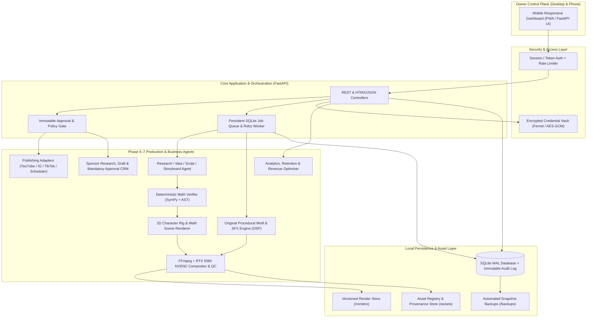

# Math Mayhem — System Architecture

## 1. Host Environment Inventory (Verified 2026-11-11)
| Component | Detected Specification | Status / Notes |
| :--- | :--- | :--- |
| **Operating System** | Windows 11 (`10.0.26200-SP0`) | Verified |
| **CPU** | 16 Logical Processors | Verified |
| **GPU** | **NVIDIA GeForce RTX 5080 (16,303 MiB VRAM)** | Driver `610.88`, CUDA `13.3` — Idle (`28°C`, `428 MiB` used) |
| **Storage (`C:\`)** | **1,978.65 GB Total** / **1,696.79 GB Free** (281.86 GB Used) | Plenty of high-speed space for renders, assets, and backups |
| **Python** | Python `3.13.9` | Installed (`FastAPI`, `SQLAlchemy 2.0`, `Pydantic 2.12`, `Pillow 12.1`, `Uvicorn`, `Cryptography` present) |
| **Node.js / npm** | Node `v24.11.0` / npm `11.6.1` | Installed |
| **Git & GitHub CLI** | `git 2.51.1.windows.1` / `gh 2.82.1` | Installed |
| **Docker** | Docker `29.5.3` | Installed (not required for core native GPU stack) |
| **FFmpeg** | *Not currently on PATH* | **Action in Phase 1 (`T1.2`):** Install FFmpeg with NVENC support |
| **Blender / Manim** | *Not currently on PATH* | Optional; core 2D stick-figure + math engine uses Python vector/Cairo/Pillow + SymPy + FFmpeg NVENC |

---

## 2. High-Level System Architecture



---

## 3. Core Architectural Invariants & Guardrails
1. **Strict Mathematical Accuracy (`MathVerifier`):**
   - Every mathematical expression shown on screen is parsed and verified via deterministic symbolic/numerical checks (`SymPy`).
   - Division by zero (`10 / 0`, `0 / 0`) is strictly classified as `UNDEFINED` in ordinary arithmetic—never assigned a numerical result.
   - Fictional consequences (e.g., cartoon void opening) are explicitly tagged in the scene schema as `fictional_metaphor=True` and visually separated from mathematical notation.
2. **Canonical Character Contract (`CharacterRig`):**
   - Simple stick-figure adventurer: **messy short hair, short beard, blank-lens glasses (no pupils), NO backpack**.
   - **Silent (`speaks=False`, `vocalizes=False`, `narrator=False`)**: all storytelling and humor work muted through posture, head-tilt, gesture, timing, and readable props.
3. **Audio & Asset Provenance (`AssetRegistry`):**
   - Every audio/music/visual asset in the database requires `source`, `license_type`, `commercial_use_cleared=True`, `sponsored_use_cleared=True`, and `provenance_record`.
   - The 3–5s musical motif (Playful, Suspense, Chaos, Ending) is generated procedurally in-house so Math Mayhem owns 100% of the IP with zero Content-ID collision risk.
4. **Immutability After Approval (`EpisodeVersion`):**
   - Once an `EpisodeVersion` is marked `APPROVED` by the owner, its video hash (`sha256`), script, storyboard, caption package, and metadata are locked by database-level triggers/guards. Any revision creates a new `version_number` requiring fresh approval.
5. **Publishing & Sponsor Safety Gates (`ApprovalGate`):**
   - No video can transition to `PUBLISHING` or `PUBLISHED` without an explicit `ApprovalLog` entry referencing the exact `episode_id` and `version_id` (individually or in an explicitly enumerated batch ID list).
   - Sponsor CRM enforces `substantive_email_requires_approval=True`: initial outreach, substantive replies, rate quotes, counteroffers, and contract discussions stay in `PENDING_OWNER_APPROVAL` until the owner approves the exact `recipient`, `subject`, `body_sha256`, and `terms`.
6. **Multi-User Readiness Without Premature Multi-Tenancy:**
   - Core tables include `owner_id` (defaulting to `'owner_primary'`) and clean service boundaries so multi-user support can be enabled later without schema rewrites.

---

## 4. Planned Directory Structure (Phase 1)
```text
MathMayhem/
├── app/
│   ├── __init__.py
│   ├── main.py              # FastAPI app, routes, mobile-responsive dashboard shell
│   ├── config.py            # Pydantic Settings & environment loader
│   ├── security.py          # Encrypted credential vault (Fernet) & auth middleware
│   ├── logging_config.py    # Structured rotating file + console logging
│   ├── database.py          # SQLAlchemy 2.0 engine (SQLite WAL) & session management
│   ├── models.py            # ORM models + immutability guards + audit log
│   ├── schemas.py           # Pydantic request/response & pipeline schemas
│   ├── queue.py             # Persistent SQLite job queue, retries & crash recovery
│   ├── render_smoke.py      # Phase 1 GPU (RTX 5080 NVENC) + FFmpeg + procedural audio smoke test
│   ├── templates/           # Mobile-responsive HTML templates
│   └── static/              # CSS / JS assets
├── assets/
│   ├── character/           # Canonical model sheets & vector rigs (Phase 2)
│   ├── audio/               # Original procedural motifs & rights-cleared SFX
│   └── props/               # Calculator & mathematical props
├── renders/
│   ├── previews/            # Low-res preview renders
│   └── masters/             # Approved 1080x1920 @ 30fps master renders
├── data/
│   └── math_mayhem.db       # Local SQLite WAL database
├── backups/                 # Timestamped atomic DB & config backups
├── logs/                    # Rotating application & render logs
├── scripts/
│   └── backup.py            # Automated backup & restore verification CLI
├── tests/                   # Automated pytest acceptance suite per phase
├── ARCHITECTURE.md
├── BLOCKERS.md
├── CHANGELOG.md
├── DECISIONS.md
├── Math_Mayhem_Antigravity_Master_Prompt.md
├── PROJECT_STATUS.md
├── RUNBOOK.md
├── TASKS.md
└── TEST_RESULTS.md
```


---

## 11. Cairo Production Character Rig & Interaction Architecture (Phase A Polish)

```
                       ┌───────────────────────┐
                       │  OptionCCharacterSpec │
                       └───────────┬───────────┘
                                   │
                                   ▼
┌──────────────────┐     ┌─────────────────────┐     ┌───────────────────────┐
│  CairoRigState   ├───► │ solve_cairo_anatomy ├────►│  SolvedCairoAnatomy   │
│  (Pelvis, Lean,  │     │ (2-Bone IK Legs/Arms│     │  (Joint Landmark Pts) │
│   Nod, Wrists)   │     │  Bounded Shoulders) │     └───────────┬───────────┘
└──────────────────┘     └─────────────────────┘                 │
                                                                 ▼
                                                     ┌───────────────────────┐
                                                     │draw_option_c_character│
                                                     │ - _draw_tapered_limb  │
                                                     │   (36-step Bezier)    │
                                                     │ - _draw_hand (aligned)│
                                                     │ - Symmetric Eyes/Face │
                                                     └───────────────────────┘
```

- **Limb Curvature Engine (`_draw_tapered_limb`):** 36-step continuous quadratic Bézier curve passing organically through joint $p_1$ with a smooth spline thickness profile, eliminating apex pinching and discretization artifacts.
- **Shoulder Attachment:** Torso lean ($\theta_{\text{lean}} \in [7.5^\circ, 17.5^\circ]$) dynamically accommodates reach distance; shoulder protraction is clamped ($dx \le 16.7\text{ px} < 18.9\text{ px}$ combined radius), guaranteeing 100% gapless physical overlap across all frames.
- **Hand Pointer Orientation:** Front hand cap automatically rotates along the forearm approach vector when reaching or pressing calculator keys, ensuring smooth, natural alignment with button faces.
- **Calculator Display:** Dual-line LCD bezel with responsive TrueType text fitting (`fit_math_font`), right-aligned $68\text{pt}$ numeric results, and prominent bold red $48\text{pt}$ `UNDEFINED` display.
