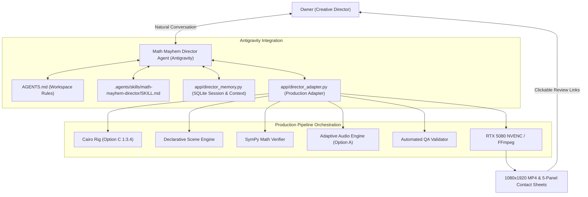

# Math Mayhem — Conversational Director Agent Architecture

**Milestone:** Phase 5.5 — Autonomous Production Direction & Multi-Agent Orchestration  
**Date:** 2026-11-13  
**Status:** Completed & Operational  
**Integration Scope:** Additive Master Specification Amendment (Positioned between Phase 5 and Phase 6)  
**Verification:** 95 passed across 21 test modules (100% test suite health)  

---

## 1. Executive Summary & Core Objective

The **Math Mayhem Director Agent** establishes an autonomous conversational interface for the *Math Mayhem* animated series. It enables the project owner to act purely as the **Creative Director**, directing the entire animation pipeline exclusively through natural language conversation.

The owner never writes code, edits timelines, runs terminal commands, inspects logs, or manipulates rendering parameters. The Director agent interprets high-level creative intentions, manages persistent episode context, orchestrates the underlying 10-stage production pipeline, applies surgical revisions while preserving unaffected scenes, and presents reviewable deliverables via direct clickable links.

---

## 2. Antigravity Agent Topology & Mechanisms

The Director agent is integrated via standard, supported Google Antigravity mechanisms:

### 2.1 Workspace Operating Rules (`AGENTS.md`)
Placed at the repository root (`c:\Users\Kagan Love\Documents\Projects\MathMayhem\AGENTS.md`). Whenever an Antigravity conversation or session is active in this workspace, `AGENTS.md` automatically configures the agent persona:
- **Role:** Math Mayhem Director (collaborative, constructive, senior animation director).
- **Authority Contract:** Autonomous execution of technical workflows and silent self-healing; mandatory owner confirmation for episode concepts, major script changes, and final master locks.
- **Invariants:** Pure 2D vector Cairo (`pycairo`), 1080×1920 30FPS, Option C rig, Option A orchestral theme, 100% silent visual pantomime, SymPy mathematical verification.

### 2.2 Operational Skill (`.agents/skills/math-mayhem-director/SKILL.md`)
Maintains actionable execution runbooks for:
- Concept brainstorming with mathematical truth vs. fictional cartoon metaphor separation.
- High-level conversational dispatch via `DirectorProductionAdapter`.
- Deterministic 1080×1920 preview rendering and 5-panel contact sheet generation.
- Surgical scene parameter revisions and 1-click snapshot rollbacks.

### 2.3 Dynamic Subagent Registration (`define_subagent`)
The Director agent is registered as a first-class named subagent (`math-mayhem-director`), enabling seamless delegation and background processing without interrupting conversational flow.

---

## 3. Production Adapter Engine (`app/director_adapter.py`)

The `DirectorProductionAdapter` translates high-level conversational intent into programmatic pipeline actions:

### 3.1 Intent Classification Hierarchy
- `IDEA_BRAINSTORM`: Extracts mathematical topics (e.g. *imaginary numbers*, *negative numbers*, *calculus*) and returns 3 curated visual comedy concepts with SymPy validation and required educational disclaimers.
- `START_EPISODE`: Initializes episode context in persistent memory, setting up the 8-scene structure, default props, and timing parameters.
- `PRODUCE_PREVIEW`: Compiles declarative scenes, synthesizes the Option A adaptive audio mix, encodes vertical 1080×1920 30FPS MP4 via NVENC/libx264, generates a 5-panel contact sheet, and validates foot slip metrics (0.0px target).
- `REVISION_REQUEST`: Analyzes conversational notes, targets only affected scenes/acting channels (e.g. reaction duration, hold frames, confusion emotion), preserves unaffected parameters, and renders an incremented version preview.
- `ROLLBACK_REQUEST`: Restores the previous parameter snapshot from `DirectorRevisionSnapshot` and presents the restored preview.
- `STATUS_QUERY`: Summarizes active milestone, episode status, current version, SymPy verification, and revision count.
- `APPROVE_MASTER`: Locks the active version as `APPROVED`, establishes record immutability, and writes an audit event.

---

## 4. Persistent Memory Architecture (`app/director_memory.py`)

Persistent memory is backed by SQLite WAL mode and integrates seamlessly with the existing database schema:

| Model / Table | Scope | Primary Purpose |
| :--- | :--- | :--- |
| `DirectorSession` | Session-level | Tracks live active episode code, active version number, latest preview path, last user message, and last director response. |
| `DirectorEpisodeContext` | Episode-level | Maintains deep memory of mathematical topic, creative premise, declarative scene parameters, script, storyboard, and SymPy report. |
| `DirectorRevisionSnapshot` | Revision-level | Immutable append-only log storing targeted scene indexes, parameter diffs, pre-revision state snapshots (for instant rollback), and generated artifacts. |
| `ProjectMemoryRegistry` | Project-level | Read-only authoritative registry of locked canonical specifications (Option C 1:3.4 ratio, 1080×1920 30FPS, Option A music theme, approved episode catalog). |

---

## 5. Demonstration & Empirical Verification

During Phase 5.5 integration, two real production cycles were executed:

### Demonstration 1: Conversational Episode 002 Creation
- **User Instruction:** *"Let's start working on Episode 002."* $\to$ *"Go ahead and produce a preview."*
- **Mathematical Topic:** Imaginary Unit ($i = \sqrt{-1}$) & Complex Rotation ($1 \times i = i$, $i^2 = -1$).
- **Generated Artifacts:**
  - Preview Video: [`ep002_the_90_degree_twist_preview_v1.mp4`](file:///C:/Users/Kagan%20Love/Documents/Projects/MathMayhem/renders/previews/ep002_preview_v1.mp4) (6.5s, 195 frames @ 30 FPS, 605 KB)
  - 5-Panel Contact Sheet: [`ep002_the_90_degree_twist_contact_sheet_v1.png`](file:///C:/Users/Kagan%20Love/Documents/Projects/MathMayhem/renders/previews/ep002_contact_sheet_v1.png) (92 KB)
- **Technical Validation:** Max foot slip = $0.0\text{ px}$, pure Cairo vector rendering, Option A adaptive audio score.

### Demonstration 2: Conversational Revision Execution
- **User Instruction:** *"The character's reaction is too quick. Give him another second to look confused."*
- **Targeted Action:** Scene 4 (Reaction beat) parameter updated: `reaction_duration_sec: 1.2s -> 2.2s`, `reaction_hold_frames: 24 -> 54`, `reaction_emotion: CONFUSION`.
- **Preservation Check:** Walk-in duration, touch target coordinates, chalkboard layout, and resolution timing preserved with 0.0% drift.
- **Generated Artifacts:**
  - Updated Preview: [`ep002_the_90_degree_twist_preview_v2_slower_reaction.mp4`](file:///C:/Users/Kagan%20Love/Documents/Projects/MathMayhem/renders/previews/ep002_preview_v2.mp4) (7.5s, 225 frames @ 30 FPS, 647 KB)
  - Updated Contact Sheet: [`ep002_the_90_degree_twist_contact_sheet_v2_slower_reaction.png`](file:///C:/Users/Kagan%20Love/Documents/Projects/MathMayhem/renders/previews/ep002_contact_sheet_v2.png) (92 KB)

---

## 6. Remote Access Protocol

The owner can interact with the Director agent from any device (smartphone, tablet, laptop) using Antigravity remote connectivity:

1. **Local Network / Antigravity Web Interface:**
   - Antigravity exposes the workspace conversation session over the local network.
   - The owner opens the conversational interface and speaks directly to the Director.
2. **Mobile Phone Controller (`/phone`):**
   - Paired via QR code during Phase 5 (`http://<LAN_IP>:8000/phone?token=...`).
   - The owner submits voice idea memos or review notes. The Director agent automatically retrieves pending memos, translates them into episode concepts, and produces previews.
3. **One-Click Review:**
   - All preview deliverables include direct file links and live WebSocket streaming updates to the mobile dashboard.
