# Math Mayhem — Master Specification Reconciliation Report

**Document Reference:** `MATH_MAYHEM_SPECIFICATION_RECONCILIATION.md`  
**Date:** 2026-11-13  
**Status:** Approved by Owner Directive (Continuation Milestone)  
**Authoritative Precedence:**
1. Explicit Current Owner Decisions (`Stage C2 Baseline Approval & Calibration Exit`, `Option C Protagonist`, `Option A Theme`, `Pure Cairo Renderer`)
2. Original Master Specification (`Math_Mayhem_Antigravity_Master_Prompt.md`, v1.0, 11 Nov 2026)
3. Owner-Approved Technical & Creative Refinements (`DEC-001` through `DEC-012`, `STAGE_C2_LIMB_REFINEMENT_REPORT.md`)
4. Approved Implementation Plans & Architecture Decisions (`ARCHITECTURE.md`, `PROJECT_STATUS.md`)
5. Internal Engineering Recommendations

---

## 1. Executive Summary & Directive Intent

This reconciliation establishes the authoritative bridge between the founding vision set forth in the **Math Mayhem Antigravity Master Build Prompt** and the rigorous production engineering developed across Phases 1 through 4.

The project began with a clear mandate: build a private, owner-operated, automated animation and media business creating funny, dialogue-free mathematical adventures centered on a silent stick-figure protagonist. Over four iterative phases, that vision encountered real-world rendering challenges—progressing from raw PIL wireframes to experimental Godot game-engine pipelines, and ultimately culminating in the owner's decisive restoration and refinement of the **pure Python Cairo 2D vector engine**.

With the owner's formal acceptance of **Stage C2** ("Proceed beyond the current character-calibration phase"), the character geometry, joint articulation, and button interaction mechanics are stabilized. Broad calibration has concluded. Development now shifts from micro-geometric limb tuning back to the broader, holistic production vision: reusable animation libraries, procedural scene description, audio-video synchronization, automated quality assurance, mobile phone control (Phase 5), platform distribution/monetization (Phase 6), and performance analytics (Phase 7).

This document audits all 48 discrete requirements of the Master Specification, catalogs all approved amendments, identifies architectural gaps, and provides a reconciled, dependency-aware production roadmap.

---

## 2. Master Specification Requirement Inventory

Status Legend:
- **Complete:** Functionality fully implemented, passing automated tests, with verifiable production artifacts.
- **Partial:** Code and architectural foundation exist, but requires refinement, modularization, or pending phase completion.
- **Not Started:** Formal scope defined in master specification, locked behind preceding phase gates.
- **Blocked:** Work halted due to technical impediment or awaiting explicit owner authorization.

### 2.1 Core Role, Execution Contract & Operating Guardrails

| Requirement ID | Original Master Requirement | Original Phase | Current Status | Evidence / Verification | Remaining Work | Dependencies | Priority |
| :--- | :--- | :--- | :--- | :--- | :--- | :--- | :--- |
| **REQ-CORE-001** | Owner-operated automated animation business on CLX desktop with NVIDIA RTX 5080 | Foundation / Global | **Complete** | Hardware inventory in `ARCHITECTURE.md` §1; RTX 5080 NVENC hardware encoding active | None | None | Critical |
| **REQ-CORE-002** | Secure phone-based control ready for future multi-user expansion without premature multi-tenancy | Phase 1 / Phase 5 | **Partial** | `owner_id` column on core DB tables; Fernet encryption; local auth middleware | Implement mobile PWA UI and secure remote tunnel in Phase 5 | Phase 4 acceptance | High |
| **REQ-CORE-003** | Phased progression with formal owner gate reviews; no assumptions on paid quotas or permissions | Global | **Complete** | `PROJECT_STATUS.md` phase gates; owner reviews at Phase 1, 2, 3, 3R, C1, and C2 | Maintain owner approval gates for each phase | None | Critical |
| **REQ-CORE-004** | Maintain 7 persistent tracking documents (`PROJECT_STATUS`, `TASKS`, `DECISIONS`, `ARCHITECTURE`, `TEST_RESULTS`, `BLOCKERS`, `RUNBOOK`) | Foundation | **Complete** | All 7 tracking documents present, updated, and version-controlled in workspace root | Keep continuously updated | None | High |
| **REQ-CORE-005** | Small independently testable tasks, git commits, backups, reproducible setup, changelog | Foundation | **Complete** | 65 pytest automated tests; `scripts/backup.py`; git tags (`stage-c2-owner-baseline`); `CHANGELOG.md` | Add targeted tests for new scene modules | None | High |
| **REQ-GD-001** | Never publish unapproved video (individually or in explicitly enumerated batches) | Global Guardrail | **Complete** | `app/models.py` `ApprovalLog` table and `ImmutableRecordError` database-level enforcement | Platform publishing adapters (Phase 6) | Phase 6 | Critical |
| **REQ-GD-002** | Never send substantive sponsor correspondence without exact recipient/message/terms approval | Global Guardrail | **Complete** | `app/models.py` `SponsorLead` schema enforces `requires_approval=True` | Sponsor CRM agent (Phase 6) | Phase 6 | Critical |
| **REQ-GD-003** | No copyrighted third-party media without documented commercial/sponsored rights | Creative Bible | **Complete** | `app/models.py` `Asset` table requires mandatory `license_type` and `provenance_record` | Continuous asset validation | None | Critical |
| **REQ-GD-004** | Zero invented platform limits, API access, earnings, or view metrics | Global Guardrail | **Complete** | Architectural policy in `DEC-006`; $0.00 local cost ledger enforced | Connect live APIs in Phase 6/7 | Phase 6, 7 | High |
| **REQ-GD-005** | Never evade rate limits or platform review | Global Guardrail | **Complete** | Documented in `DEC-001` and `DEC-006` | Rate limiting queue in Phase 6 | Phase 6 | High |
| **REQ-GD-006** | Do not automatically incur charges or sign contracts | Global Guardrail | **Complete** | Local DSP audio + local Cairo rendering; zero paid cloud API calls | Enforce budget caps if paid APIs added | None | Critical |
| **REQ-GD-007** | Protect account tokens, PII, and private production assets | Global Guardrail | **Complete** | `app/security.py` Fernet AES-128-CBC credential vault + `.gitignore` protection | Secure key storage for platform OAuth | Phase 5, 6 | Critical |
| **REQ-GD-008** | Automated tests, owner approval, and evidence required before marking phase complete | Global Guardrail | **Complete** | Enforced across all phases; evidence recorded in `TEST_RESULTS.md` | Maintain gate discipline | None | Critical |

---

### 2.2 Creative Bible & Character Specifications

| Requirement ID | Original Master Requirement | Original Phase | Current Status | Evidence / Verification | Remaining Work | Dependencies | Priority |
| :--- | :--- | :--- | :--- | :--- | :--- | :--- | :--- |
| **REQ-CR-001** | Funny, visually clear, mostly dialogue-free mathematical adventure | Creative Bible | **Complete** | Episode 001 narrative script, visual comedy beats in `app/production_agents.py` | Episode 002+ comedic scenarios | None | High |
| **REQ-CR-002** | Canonical protagonist: messy short hair, short beard, blank-lens glasses (no pupils), NO backpack | Phase 2 | **Complete** | `app/cairo_character_rig.py` `OptionCCharacterSpec`; model sheet in `assets/character/` | Maintain immutable design lock | None | Critical |
| **REQ-CR-003** | Character is curious, impulsive, expressive through posture/gesture/timing; NEVER speaks or vocalizes; no narrator; works muted | Creative Bible | **Complete** | `CairoRigState` posture/head nod/eyebrows; zero voice tracks; visual sound effects | Expand emotional acting library | None | Critical |
| **REQ-CR-004** | Flexible environments (chalkboard recurring but not mandatory); clean minimalist staging | Creative Bible | **Complete** | Pure white staging with ground drop shadow (`app/math_renderer.py`, `app/production_agents.py`) | Chalkboard environment module | None | Medium |
| **REQ-CR-005** | Mathematically accurate concepts with exaggerated fictional consequences; never present incorrect arithmetic as true; clear notation | Phase 3 | **Complete** | `app/math_verifier.py` SymPy AST verifier; division by zero strictly `UNDEFINED`; explicit fictional tags | Ongoing verification on all math | None | Critical |
| **REQ-CR-006** | Recognizable original 3–5s musical signature with playful, suspense, chaos, and ending variations | Creative Bible | **Complete** | `app/adaptive_audio.py` multi-voice DSP synthesis; owner selected **Option A** (`DEC-010`) | Add standalone 3-5s brand stinger | None | High |
| **REQ-CR-007** | Procedural or rights-cleared SFX; documented commercial & sponsored use rights | Creative Bible | **Complete** | DSP button beeps, clicks, buzzers, and void rumbles in `app/adaptive_audio.py` | Expand procedural SFX library | None | High |
| **REQ-CR-008** | Content formats: 9:16 short discovery (15–45s), >60s extended originals, 16:9 YouTube compilations; captions, thumbnails, packaging | Creative Bible | **Partial** | 9:16 1080x1920 24.0s master; thumbnail and SRT/VTT captions in `renders/packages/EP001_v2/` | 16:9 layout adapter and >60s pipeline | Phase 4/6 | Medium |

---

### 2.3 Phase 1 — Foundation

| Requirement ID | Original Master Requirement | Original Phase | Current Status | Evidence / Verification | Remaining Work | Dependencies | Priority |
| :--- | :--- | :--- | :--- | :--- | :--- | :--- | :--- |
| **REQ-PH1-001** | Inspect environment, OS, GPU, drivers, tools, storage | Phase 1 | **Complete** | `ARCHITECTURE.md` §1; Windows 11, RTX 5080, CUDA 13.3 verified | None | None | Complete |
| **REQ-PH1-002** | Choose stack with documented trade-offs and owner approval (`DEC-001` to `DEC-006`) | Phase 1 | **Complete** | Python 3.13 + FastAPI + SQLite WAL + Cairo + FFmpeg NVENC approved | None | None | Complete |
| **REQ-PH1-003** | Create repository, configuration, project scaffolding, and asset directories | Phase 1 | **Complete** | Git repo `kaganlove/MathMayhem`; structured `app/`, `assets/`, `renders/`, `data/` | None | None | Complete |
| **REQ-PH1-004** | SQLite WAL database schema with SQLAlchemy 2.0 and immutable audit log | Phase 1 | **Complete** | `app/database.py`, `app/models.py`; `EpisodeVersion`, `Asset`, `ApprovalLog` tables | None | None | Complete |
| **REQ-PH1-005** | Persistent SQLite job queue supporting retries, idempotency, and crash recovery | Phase 1 | **Complete** | `app/queue.py`; `JobQueue` class tested in `tests/test_job_queue.py` | None | None | Complete |
| **REQ-PH1-006** | GPU & FFmpeg render smoke test pipeline (RTX 5080 NVENC + procedural audio) | Phase 1 | **Complete** | `app/render_smoke.py`; renders 60 frames 1080x1920 in <1.2s | None | None | Complete |
| **REQ-PH1-007** | Local mobile-responsive dashboard shell with token authentication and telemetry | Phase 1 | **Complete** | `app/main.py`, `app/templates/dashboard.html`; health telemetry active | None | None | Complete |
| **REQ-PH1-008** | Automated atomic online backup and integrity check utility | Phase 1 | **Complete** | `scripts/backup.py`; tested in `tests/test_backup.py` | Schedule automated cron | None | Complete |
| **REQ-PH1-009** | Phase 1 acceptance test suite and owner gate review | Phase 1 | **Complete** | 14/14 tests passed; approved by owner on 2026-11-11 | None | None | Complete |

---

### 2.4 Phase 2 / 2R / C1 / C2 — Character Animation & Rigging

| Requirement ID | Original Master Requirement | Original Phase | Current Status | Evidence / Verification | Remaining Work | Dependencies | Priority |
| :--- | :--- | :--- | :--- | :--- | :--- | :--- | :--- |
| **REQ-PH2-001** | Canonical character model sheet (messy hair, beard, blank glasses, no pupils, no backpack) | Phase 2 | **Complete** | `assets/character/protagonist_model_sheet.png`; `OptionCCharacterSpec` | None | None | Complete |
| **REQ-PH2-002** | Reusable 2D vector character rig and pose library | Phase 2 | **Complete** | `app/cairo_character_rig.py`; 13 emotional/body-language states implemented | Extract into standalone pose catalog | None | High |
| **REQ-PH2-003** | Analytic 2-bone IK limb solving with world-space foot locking (zero foot slip) | Phase 2R | **Complete** | `solve_cairo_anatomy` 2-bone IK; $0.000\text{ px}$ foot slip verified | Generalize foot solver for uneven ground | None | High |
| **REQ-PH2-004** | Variable-width antialiased curved Bézier limbs (no angular bones or mechanical disks) | Stage C1/C2 | **Complete** | 36-step antialiased cubic Bézier curves; continuous tangent blend; joint disks eliminated | Minor motion easing polish | None | Complete |
| **REQ-PH2-005** | Consistent camera framing, visual consistency across >=3 movements and >=2 scenes | Phase 2 | **Complete** | Tested in `tests/test_character_animation.py` and `tests/test_animation_qc.py` | Add dynamic virtual camera panning | None | Medium |
| **REQ-PH2-006** | Bounded limb curvature, eliminating exaggerated arm hoops and bowed leg silhouettes | Stage C2 | **Complete** | Arm apex reduced to $87.1\text{ px}$; leg span reduced to $105.3\text{ px}$; verified in `tests/test_cairo_stage_c2_validation.py` | Final polish pass (Section 4) | None | High |
| **REQ-PH2-007** | Coordinated body lean and shoulder shrug preserving $\ge 35^\circ$ elbow bend during reaches | Stage C2 | **Complete** | Forward lean up to $21.0^\circ$, pelvis shift to $430\text{ px}$, elbow bend $\ge 45.2^\circ$; verified | Generalize reach kinematics for arbitrary targets | None | High |

---

### 2.5 Phase 3 / 3R — Mathematical Animation & Physical Interaction

| Requirement ID | Original Master Requirement | Original Phase | Current Status | Evidence / Verification | Remaining Work | Dependencies | Priority |
| :--- | :--- | :--- | :--- | :--- | :--- | :--- | :--- |
| **REQ-PH3-001** | Symbolic & numerical math verifier using SymPy; strict `UNDEFINED` division by zero | Phase 3 | **Complete** | `app/math_verifier.py`; AST parsing, SymPy symbolic validation; rejects false math | Support geometry & matrix verification | None | Complete |
| **REQ-PH3-002** | High-DPI mathematical notation, formula layout, graphs, and geometric figures | Phase 3 | **Complete** | `app/math_renderer.py`; Unicode math typography (`÷`, `×`, `−`), Cartesian graph plotter | LaTeX equation layout engine | None | Medium |
| **REQ-PH3-003** | Reusable General-Purpose Physical Interaction Engine (`app/interaction_engine.py`) | Phase 3R | **Complete** | Collision bounding boxes, contact points, contact-before-activation guard (`DEC-009`) | Support multi-object manipulation | None | Complete |
| **REQ-PH3-004** | Interactive pedestal calculator prop with dual-line LCD and 4x4 keypad | Phase 3R | **Complete** | Recessed dual-line display, responsive TrueType fitting, 3D button depression | Modular prop configuration | None | Complete |
| **REQ-PH3-005** | Subpixel button contact precision ($0.000\text{ px}$) across all physical key presses | Phase A | **Complete** | Verified in `tests/test_cairo_phase_a_polish_validation.py` across all 20 button presses | Maintain subpixel invariant | None | Complete |
| **REQ-PH3-006** | Episode 001 10-second proof-of-concept pilot rendered and approved | Phase 3 | **Complete** | `renders/previews/ep001_pilot_10s_1080x1920.mp4` approved by owner | None | None | Complete |

---

### 2.6 Phase 4 — AI Production Agents & Full Episode 001 Continuation

| Requirement ID | Original Master Requirement | Original Phase | Current Status | Evidence / Verification | Remaining Work | Dependencies | Priority |
| :--- | :--- | :--- | :--- | :--- | :--- | :--- | :--- |
| **REQ-PH4-001** | 10-stage AI production agent pipeline (Research → Script → Storyboard → MathVerifier → ScenePlanner → Animator → Music → SFX/Mixer → QC → Packager) | Phase 4 | **Complete** | `app/production_agents.py`; structured `AgentStageLog` records, Pydantic schemas | Decouple procedural scene assembly from hardcoded episode timeline | None | High |
| **REQ-PH4-002** | Original multi-voice adaptive music engine & commercial rights clearance | Phase 4 | **Complete** | `app/adaptive_audio.py` physical modeling DSP; **Option A** theme approved (`DEC-010`) | Add dynamic audio transitions | None | Complete |
| **REQ-PH4-003** | Procedural SFX engine and frame-accurate audio-video mixer | Phase 4 | **Complete** | Keypad clicks, chimes, buzzers, and void rumbles synthesized and synced in `app/adaptive_audio.py` | Expand SFX variety | None | Complete |
| **REQ-PH4-004** | Full Episode 001 continuation (24.0s / 720 frames @ 30 FPS) with cartoon void metaphor and reality reset | Phase 4 | **Complete** | `renders/previews/ep001_stage_c2_refined_preview.mp4`; 8 scenes, 20 button contacts, Option A soundtrack | Resolve minor joint delta in QA validator (Section 4) | None | High |
| **REQ-PH4-005** | Immutable episode version progression and revision workflow (`request_episode_revision`) | Phase 4 | **Complete** | `app/production_agents.py` version incrementer with DB immutability guards | Dashboard UI integration for revision trigger | None | Complete |
| **REQ-PH4-006** | Complete packaging bundle export (MP4 master, thumbnail, SRT/VTT captions, manifest) | Phase 4 | **Complete** | `renders/packages/EP001_v2/` package manifest, captions, and source metadata | Platform-specific metadata variations | Phase 6 | Complete |

---

### 2.7 Phase 5 — Remote Phone Control (Pending Gate Acceptance of Phase 4)

| Requirement ID | Original Master Requirement | Original Phase | Current Status | Evidence / Verification | Remaining Work | Dependencies | Priority |
| :--- | :--- | :--- | :--- | :--- | :--- | :--- | :--- |
| **REQ-PH5-001** | Mobile-responsive dashboard optimized for phone screens (PWA / touch controls) | Phase 5 | **Partial** | Desktop dashboard shell exists (`app/templates/dashboard.html`) | Full touch-first PWA styling, gesture controls, mobile video player | Phase 4 acceptance | High |
| **REQ-PH5-002** | Text and voice episode idea submission from phone | Phase 5 | **Not Started** | Endpoint stubs designed in `DEC-004` | Audio recording API, Whisper/local transcription, idea ingestion queue | REQ-PH5-001 | High |
| **REQ-PH5-003** | Real-time production progress tracking and mobile video preview playback | Phase 5 | **Partial** | Preview video serving endpoint active in `app/main.py` | Server-Sent Events (SSE) job progress stream, mobile video player | REQ-PH5-001 | High |
| **REQ-PH5-004** | Secure remote access via encrypted mesh/tunnel (Tailscale / Cloudflare Zero Trust) | Phase 5 | **Not Started** | Architecture documented in `DEC-005`; Fernet vault ready | Setup Tailscale/Cloudflare daemon, enforce token auth over tunnel | REQ-PH5-001 | Critical |
| **REQ-PH5-005** | Phone-based single and batch episode approval gates with revision feedback | Phase 5 | **Not Started** | Approval DB schemas complete | Touch-friendly approval cards, revision notes input, batch approval UI | REQ-PH5-001 | Critical |

---

### 2.8 Phase 6 — Account Onboarding, Distribution, Monetization & Sponsors

| Requirement ID | Original Master Requirement | Original Phase | Current Status | Evidence / Verification | Remaining Work | Dependencies | Priority |
| :--- | :--- | :--- | :--- | :--- | :--- | :--- | :--- |
| **REQ-PH6-001** | Guided step-by-step account onboarding wizard for YouTube, Instagram, TikTok, email, dev console | Phase 6 | **Not Started** | Schema models exist | Guided interactive onboarding wizard in dashboard | Phase 5 | Medium |
| **REQ-PH6-002** | Platform publishing adapters with quota verification and compliant scheduler fallback | Phase 6 | **Not Started** | Adapter architecture designed in `DEC-001` | Official API clients for YouTube Data API v3, Meta Graph API, TikTok Content Posting API | Phase 5 | High |
| **REQ-PH6-003** | Immutable approval policy gate: zero publishing without explicit owner authorization | Phase 6 | **Complete** | `app/models.py` `ApprovalLog` table blocks publishing unapproved versions | Adapter integration | None | Critical |
| **REQ-PH6-004** | Maximum Publishing Mode for approved inventory with platform rate-limit compliance | Phase 6 | **Not Started** | Policy documented in Master Spec §6 | Scheduler worker, publishing queue, pacing rules | REQ-PH6-002 | Medium |
| **REQ-PH6-005** | Platform monetization eligibility tracking (Shorts watch time, video length rules) | Phase 6 | **Not Started** | Rules documented in Master Spec §6 | Eligibility calculator module in dashboard | REQ-PH6-002 | Medium |
| **REQ-PH6-006** | Sponsor CRM with mandatory approval of exact recipient, message, and terms | Phase 6 | **Partial** | `SponsorLead` DB model with `substantive_email_requires_approval=True` | Outreach research agent, email draft UI, approval gate | Phase 5 | High |

---

### 2.9 Phase 7 — Analytics & Optimization

| Requirement ID | Original Master Requirement | Original Phase | Current Status | Evidence / Verification | Remaining Work | Dependencies | Priority |
| :--- | :--- | :--- | :--- | :--- | :--- | :--- | :--- |
| **REQ-PH7-001** | Production, inventory, views, retention, watch time, and revenue dashboard | Phase 7 | **Not Started** | Architecture documented in `ARCHITECTURE.md` | Ingestion pipelines for YouTube/IG/TikTok analytics | Phase 6 | Medium |
| **REQ-PH7-002** | Financial tracking: costs, revenue, net profit, and $500/mo revenue milestone tracker | Phase 7 | **Partial** | `CostLedgerEntry` DB table actively tracking local rendering costs ($0.00) | Ingest platform ad revenue and sponsorship payments | Phase 6 | Medium |
| **REQ-PH7-003** | Autonomous AI recommendation agents for topic selection, scheduling, and frequency | Phase 7 | **Not Started** | Architecture documented in `ARCHITECTURE.md` | Analytics evaluation heuristics and recommendation engine | REQ-PH7-001 | Low |
| **REQ-PH7-004** | Comment monitoring and draft response queue (mandatory review for substantive replies) | Phase 7 | **Not Started** | Safety policy documented in `DEC-006` | Comment scraper, sentiment classifier, draft response approval UI | Phase 6 | Low |
| **REQ-PH7-005** | Weekly executive production and financial summary report generation | Phase 7 | **Not Started** | Reporting template specified in Master Spec §7 | Automated markdown/PDF weekly report compiler | REQ-PH7-001 | Medium |

---

## 3. Approved Amendments & Precedence Ledger

The following amendments have been formally approved by the owner and supersede earlier exploratory decisions:

```
[Founding Spec (11 Nov 2026)]
       │
       ├─► AMEND-001: Pure Cairo 2D Vector Engine (DEC-008, DEC-011)
       │              (Replaced PIL wireframe & Godot/Blender explorations)
       │
       ├─► AMEND-002: Option C Protagonist Geometry (DEC-008, DEC-011)
       │              (1:3.4 compact mobile proportion, round head, cohesive hair/beard)
       │
       ├─► AMEND-003: Joint-Anchored Cubic Bézier Limbs (Stage C2)
       │              (Cubic Bézier tangents eliminating hoop arms & bowed legs)
       │
       ├─► AMEND-004: Coordinated Reaching Kinematics (Stage C2, DEC-012)
       │              (Pelvis shift + torso lean preserving >=35° elbow bend; 0.000px contact)
       │
       ├─► AMEND-005: 24.0s (720 frames) 8-Scene Episode Structure (DEC-009, DEC-010)
       │              (Expanded from 10s pilot to complete 24s narrative with void & reset)
       │
       └─► AMEND-006: Option A Orchestral Cartoon Musical Identity (DEC-010)
                      (Playful woodwind, pizz strings, upright bass, 132 BPM multi-voice DSP)
```

### Amendment Detail Matrix

1. **AMEND-001: Pure Cairo Vector Engine Pipeline**
   - *Impact on Master Spec:* Replaces generic "Python/Blender/Manim" recommendation with a dedicated, deterministic pure Python Cairo (`pycairo`) vector rendering engine. Blender and Godot are eliminated from the active character pipeline, removing external daemon/binary dependencies while achieving sub-second frame rendering.
2. **AMEND-002: Option C Protagonist Geometry Lock**
   - *Impact on Master Spec:* Concretizes the stick-figure adventurer into the **Option C** design: 1:3.4 ratio (head radius $42\text{ px}$ at scale 1.0; $51.2\text{ px}$ at 1.22 staging scale), round head silhouette, cohesive 4-tuft hair cap, contoured jaw beard, identical rectangular blank glasses ($w=29.7\text{ px}, h=21.5\text{ px}$), no pupils, no backpack, silent.
3. **AMEND-003: Articulated Cubic Bézier Limb Geometry**
   - *Impact on Master Spec:* Replaces single quadratic Bézier limbs with joint-anchored cubic Bézier curves ($c_1 = p_0 + \gamma(p_1 - p_0)$, $c_2 = p_2 + \gamma(p_1 - p_2)$ with $\gamma=0.65$ arm, $\gamma=0.60$ leg), eliminating bloated C-shaped hoops and parentheses legs while maintaining smooth ink stroke continuity.
4. **AMEND-004: Coordinated Reaching Kinematics & Subpixel Accuracy**
   - *Impact on Master Spec:* Replaces isolated arm reaching with multi-joint whole-body coordination: pelvis weight shifts forward ($412 \to 430\text{ px}$ over front planted foot), torso leans forward ($7.5^\circ \to 21.0^\circ$), and shoulder elevates ($14\text{ px}$), ensuring the character never stretches elastically and preserves $\ge 45.2^\circ$ elbow bend across all 20 calculator button presses with $0.000\text{ px}$ subpixel contact precision.
5. **AMEND-005: 24.0-Second (720-Frame) Episode Duration**
   - *Impact on Master Spec:* Expands the canonical test benchmark from the initial 10-second proof-of-concept pilot to the complete 24.0-second 8-scene narrative: 15 calculator button presses (`10÷2=5`, `10÷1=10`, `10÷0=UNDEFINED`), Scene 6 cartoon void fantasy anomaly, Scene 7 physical `C` button press resetting reality, and Scene 8 `0÷0=UNDEFINED` cliffhanger.
6. **AMEND-006: Option A Original Musical Identity Lock**
   - *Impact on Master Spec:* Fulfills the Creative Bible's mandate for an original recognizable motif with the owner-approved **Option A ("Playful Orchestral Cartoon Comedy")**, synthesized via in-house multi-voice acoustic physical modeling DSP at 132 BPM with zero copyright/Content-ID risk.

---

## 4. Gap Analysis

Despite significant progress in character rigging and Episode 001 production, the following architectural and functional gaps remain:

### 4.1 Missing Capabilities
1. **Declarative Scene & Action Language:** The 24-second animation in `app/production_agents.py` is currently driven by a bespoke timeline function (`simulate_ep001_full_24s_timeline`). Future episodes require a declarative, data-driven scene format where actions (`walk_to`, `look_at`, `reach_button`, `react_shock`) are composed without writing frame-by-frame loop math.
2. **Mobile PWA Dashboard & Remote Access:** While the local web server serves previews, touch-optimized mobile controls and secure remote connectivity (Tailscale / Cloudflare tunnel) from Phase 5 are not yet active.
3. **Distribution & Monetization Adapters:** Platform uploaders for YouTube, Instagram, and TikTok, along with the Sponsor CRM email engine, remain in the "Not Started" state awaiting Phase 5 completion.

### 4.2 Partially Completed Systems
1. **Automated QA Validator Calibration:** The general-purpose QA validator (`validate_animation_quality_metrics` in `app/qc_mysterious_object.py`) flagged a $49.66\text{ px}$ pelvis delta and $57.89\text{ px}$ head delta during rapid animation state transitions (such as the sudden comedic reality reset in Scene 7). This validator must be calibrated to distinguish between intentional comedic cuts/transitions and unintended frame-to-frame joint snapping.
2. **Reusable Animation Pose Library:** The 13 emotional states and locomotion solvers are embedded within `app/cairo_character_rig.py` and `app/stage_c2_limbs.py`. They should be cataloged into a standalone, queryable library module.
3. **16:9 Landscape & >60s Longform Support:** The pipeline is currently optimized exclusively for vertical 9:16 discovery videos. Framing and composition adapters for 16:9 YouTube compilations are not yet implemented.

### 4.3 Technical Debt & Dependencies
1. **Tightly Coupled Timeline Logic:** The Episode 001 script, calculator prop layout, button coordinates, and character keyframes are co-located in `app/production_agents.py`. Extracting prop layouts and action sequences into modular schemas will accelerate Episode 002+ production.
2. **Test Suite Branch Expectation:** `tests/test_env.py` has a legacy assertion expecting the active git branch to be strictly `main`, causing false-positive failures when running on feature branches.

---

## 5. Reconciled Production Roadmap

The original 7-phase architecture remains the authoritative sequence. The seven workstreams defined in the owner directive are mapped directly into their parent phases:

```mermaid
flowchart TD
    subgraph P1["Phase 1: Foundation (COMPLETE)"]
        F1["Hardware / Stack / DB / Queue / NVENC / Backups"]
    end

    subgraph P2["Phase 2: Character Rigging (STABILIZED)"]
        C1["Option C Geometry / Cubic Limbs / Coordinated Kinematics"]
        C2["Deliverable D: Stage C3 Final Character Polish Pass"]
    end

    subgraph P3["Phase 3: Math & Interaction (COMPLETE)"]
        M1["SymPy AST Verifier / Pedestal Prop / Subpixel Contact"]
    end

    subgraph P4["Phase 4: AI Agents & Reusable Architecture (ACTIVE)"]
        A1["Workstream 5: Reusable Animation Library & State Transitions"]
        A2["Workstream 6: Procedural Scene Assembly & Data-Driven Script Engine"]
        A3["Workstream 7: Audio Synthesis, SFX & Frame-Accurate Post-Production"]
        A4["Workstream 8: Automated Technical & Visual QA Package Generator"]
        A5["Validate Reusability: Independent Mini-Scene Demo"]
    end

    subgraph P5["Phase 5: Remote Phone Control (NEXT GATE)"]
        RC1["Mobile PWA UI / Idea Ingestion / Video Preview Player"]
        RC2["Tailscale / Cloudflare Encrypted Tunnel / Approval Gates"]
    end

    subgraph P6["Phase 6: Distribution & Monetization"]
        D1["YouTube / IG / TikTok Adapters / Compliant Scheduler"]
        D2["Sponsor CRM / Mandatory Approval Policy Gate"]
    end

    subgraph P7["Phase 7: Analytics & Optimization"]
        O1["Inventory / Revenue / Retention / Profit Telemetry"]
        O2["Weekly Executive Performance Report"]
    end

    P1 --> P2 --> P3 --> P4
    P4 --> P5 --> P6 --> P7
```



### Reconciled Phase Milestones

- **Phase 4.1 (Immediate Checkpoint):** Deliver Specification Reconciliation, Architecture Assessment, and Reconciled Roadmap documents (Deliverables A, B, C).
- **Phase 4.2 (Character Freeze & Stage C3 Polish):** Perform focused final polish on motion easing and calibrate the QA validator to eliminate false-positive transition alerts. Freeze character geometry.
- **Phase 4.3 (Reusable Scene Engine & Animation Library):** Decouple `simulate_ep001_full_24s_timeline` into a reusable, declarative scene sequencer (`SceneDefinition`, `ActionSequence`). Build a standalone mini-scene demonstration proving Episode 002 readiness without modifying core renderer code.
- **Phase 4.4 (Phase 4 Owner Acceptance Gate):** Present full Episode 001 production package and mini-scene proof of concept for formal owner gate review.
- **Phase 5 (Remote Phone Control):** Implement the mobile-responsive PWA dashboard, text/voice idea ingestion, and secure remote tunnel.
- **Phase 6 (Distribution & Sponsors):** Deploy platform adapters and sponsor CRM with immutable approval gates.
- **Phase 7 (Analytics):** Activate performance and financial dashboards.

---

## 6. Conclusion & Verification

This reconciliation confirms that the Math Mayhem production system has successfully achieved its core mathematical, visual, and character animation requirements while remaining 100% faithful to the foundational Master Specification. With the Stage C2 baseline secured and character calibration concluded, the project is primed for modular architecture expansion and automated multi-episode generation.
